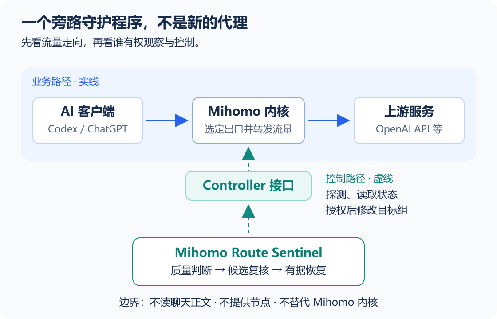

# 002 Mihomo Route Sentinel

> [!NOTE]
> **一句话定位：** 运行在Mihomo旁边的链路守护程序，发现Codex / ChatGPT真实访问异常，有依据地恢复代理路由。

<!-- sentinel:cards -->
| 交付状态 | 证据边界 |
|---|---|
| Windows · 本地投用 | 1.8.3已加载；真实故障恢复与长期观察待验收 |
| Linux / macOS · 脚本就绪 | 已有脚本，尚缺实机验收 |
| GitHub · 源码公开 | 尚无正式Release |
<!-- sentinel:/cards -->

[开始使用](README.md) · [看工作原理](docs/design.md) · [看更新历史与计划](docs/iterations.md) · [GitHub源码](https://github.com/zhoutianqi613/mihomo-route-sentinel)

## 01 背景与价值

### 1.1 问题与证据

**问题：** 2026年10月，本机出现Codex请求重试、TLS连接中断与下载截断，排查指向代理节点不稳定。通用测速地址有响应，仍不能证明ChatGPT、OpenAI API或WebSocket链路稳定。

**做法：** 将原本依靠人工复测、切换节点的恢复流程做成独立工具：探测真实业务目标，复核候选，再按约束恢复路由。

> [!NOTE]
> **证据边界：** 这是本机事件的调查结论，不能推断所有Codex重试都由代理导致。事件经过见[迭代记录](docs/iterations.md)，公开代码见[GitHub](https://github.com/zhoutianqi613/mihomo-route-sentinel)。

### 1.2 使用情境

| 情境 | 人工处理的成本 | 本项目希望交付的结果 |
|---|---|---|
| 工作中突然断线、超时 | 中断工作，逐个节点试错 | 发现持续故障，复核候选并执行受约束的恢复 |
| 节点长期偏慢但不完全断 | 面板延迟和真实业务体感不一致 | 用实际业务探测判断退化，在改善足够明显时择优 |
| 自动切换后仍不知道是否恢复 | 看见“任务运行中”却无法判断业务状态 | 明确展示实际版本、节点、健康结果、切换原因和验证身份 |

### 1.3 适用对象

**使用者：** 能够管理自己Mihomo Controller的个人用户或维护者。

## 02 系统与边界

### 2.1 流量路径

用户的AI客户端通过Mihomo访问ChatGPT和OpenAI API等上游服务。Sentinel不转发这部分业务流量，也不读取聊天正文。

### 2.2 控制链路

**读图：** 实线是业务流量，虚线是观察与控制。Sentinel不转发聊天内容，不提供节点，也不替代Mihomo内核。

Sentinel从旁通过Controller读取实际选择、探测业务链路并执行经授权的节点选择。Dry Run只报告预计动作；实际控制和守卫副作用须显式启用。

### 2.3 责任边界

- **输入：** 目标Selector、候选组与业务探测目标。
- **输出：** 健康判断、候选依据、路由控制结果与审计记录。

| 对象 | 谁负责 | Sentinel 的边界 |
|---|---|---|
| 订阅与节点供给 | 用户或订阅服务 | 不提供节点，也不保存订阅内容 |
| 代理流量转发 | Mihomo | 通过 Controller 观察和控制，不替代代理内核 |
| 客户端进程、运行模式 | Clash Verge / 系统，部分由显式守卫协助 | 守卫启用时可能恢复进程或纠正配置，部署前须理解副作用 |
| ChatGPT / OpenAI API 上游服务 | 服务提供方 | 可做启发式区分，不能修复上游故障，也不保证业务一定可用 |
| 是否切换、为何切换 | Sentinel | 默认只读；显式允许后才修改节点，并保留失败与降级信息 |

### 2.4 不适用场景

> [!WARNING]
> **不适用的边界：** 无Controller管理权、要求绝不改路由、要求操作系统硬实时保证，或只追求最低延迟。

## 03 当前交付

### 3.1 版本与平台

**产品阶段：** 运营期，仍在活跃维护。Windows / Clash Verge主路径已有部署、服务生命周期和真实Controller的历史验证记录。

**平台边界：** Linux systemd与macOS launchd已有安装管理脚本，目标平台实机验收尚未完成。

### 3.2 验证证据

| 自动化测试 | Windows实机投用 | 验收边界 |
|---|---|---|
| 本轮含文档检查共259项通过 | 已重启加载1.8.3，隐藏单实例运行 | 已确认普通复核完整采样与只读边界；真实故障注入和长期稳定性仍待验收 |

- **本地测试：** 算法交付233项通过；补充文档回归后，全量234项通过。
- **本轮文档检查：** 连续编号两级目录、原生二级标题读回、配置表宽列、路线图事实和发布保护检查纳入后，全量244项通过；这不增加真实网络验收证据。
- **实机投用：** 2026-10-30加载1.8.3，普通切前复核使用完整采样预算，缺样本不再生成故障隔离。首轮按20000ms预算完成两候选复核，候选真实质量未达准入线时仍不切换；详细证据见更新历史。
- **长期限制：** 观察中仍有延迟退化。正常启动与单次严格通过不能证明长期稳定，真实故障注入仍待验收。

完整版本变化与验证记录见[更新历史](docs/iterations.md#01-更新历史)。

### 3.3 交付状态

**发布状态：** GitHub的`main`已有项目代码；截至2026-10-26检查，尚无GitHub Release。本地或仓库版本可运行，仍需单独完成面向新用户的正式发布。

## 04 阅读导航

### 4.1 首次使用

[安装配置与使用手册](README.md)提供实际组名配置、只读验证、后台启动、状态查看和人工接管步骤。

1. 准备Node.js 20+与可访问的Controller，填写实际组名。
2. 执行单次Dry Run，核对真实健康结果。
3. 理解控制副作用后，开启后台守护。完整命令在使用手册维护。

### 4.2 日常维护

[安装配置与使用手册](README.md)按首次运行、日常操作、后台部署、配置字段和状态维护组织。运行中的选择、预算、守卫与清理入口均可从该页定位。

### 4.3 评审验收

[工作原理与业务流程](docs/design.md)说明探测、判断、候选、切换与不切换的原因；[更新历史与计划](docs/iterations.md)记录版本证据、遗留缺口与未实施事项。

### 4.4 阅读路径

先读本页确认范围和当前交付状态；操作与配置进入使用手册；需要理解判定依据时进入工作原理；需要核对版本、验收与计划时进入迭代记录。

## 05 维护方式

### 5.1 内容来源

**责任映射：** 仓库是正文唯一编辑处；飞书是生成的阅读副本；任务状态只在飞书Backlog维护。

| 变化 | 维护位置 | 责任 |
|---|---|---|
| 定位、范围与产品结论 | `PRODUCT.md` | 本次需求或产品负责人 |
| 用户操作与配置 | `README.md` | 本次实现者 |
| 控制流程与策略取舍 | `docs/design.md` | 本次实现者 |
| 阶段交付与已确认缺口 | `docs/iterations.md` | 本次需求或产品负责人 |

### 5.2 更新与发布

1. 明确本轮问题与验收标准。
2. 完成实现与验证，区分本地、投用和长期证据。
3. 更新受影响的正文；版本、关键策略参数与任务快照由发布命令读取。
4. 预览并按授权发布，核对读回结果。命令与失败处理见[文档维护](docs/iterations.md#04-文档维护)。

**版式维护：** Bear已于2026-10-26确认版式，并批准推广到另外两个项目。各仓库维护各自正文，公共排版集中管理；产品结论与网络参数仍按项目维护。

## 06 参考资料

### 6.1 事实来源

| 资料来源 | 支撑的结论 | 阅读边界 |
|---|---|---|
| [项目GitHub仓库](https://github.com/zhoutianqi613/mihomo-route-sentinel)与[安装配置手册](README.md) | 使用入口、配置字段、服务生命周期与副作用 | GitHub以公开提交为准；本页可能包含尚未提交的工作区文档 |
| `src/config.mjs`、`src/watchdog.mjs`及[工作原理](docs/design.md) | 当前默认策略、候选复核、故障恢复与设计取舍 | 参数从当前工作区源码生成，不把历史评审当作当前默认值 |
| [迭代计划与遗留问题](docs/iterations.md) | 历史提交、验证日期、平台缺口与当前Backlog快照 | 历史单次验证不等于长期SLO或本轮重新验收 |
| [Mihomo自动选择官方说明](https://wiki.metacubex.one/config/proxy-groups/url-test/) | 理解上游代理组测速与选择行为 | 只说明上游机制，不为Sentinel的业务恢复效果背书 |

### 6.2 方法参考

- [Diátaxis](https://diataxis.fr/application/)：按读者的理解、操作和查阅需求分工，不照搬整套目录。
- [arc42架构决策](https://docs.arc42.org/section-9/)：解释关键选择的背景、理由和代价，避免重复描述。
- [GitLab文档工作流](https://docs.gitlab.com/development/documentation/workflow/)：将影响用户的文档更新纳入同一次代码交付。

### 6.3 引用边界

**引用边界：** 外部方法只提供组织依据，不能证明本项目产品质量或长期维护效果。
