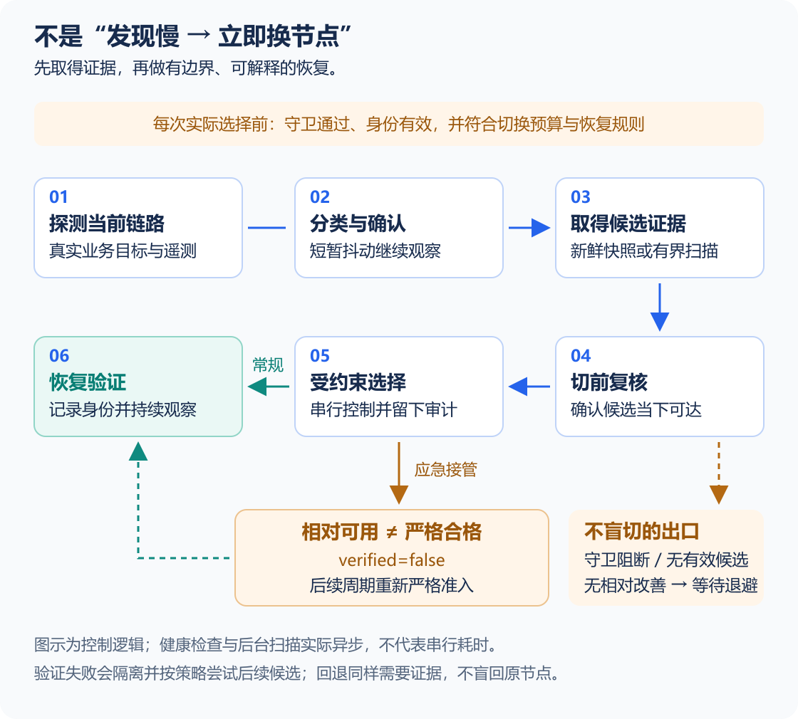

# 工作原理与业务流程

> [!NOTE]
> **阅读要点：** 先确认，再复核，最后受约束地切换。一次偏慢不立即换节点；应急接管仍须后续严格准入。

具体字段与命令见 [使用手册](../README.md)。本页数值由当前源码默认配置生成，用户实际配置可以不同。

## 01 系统模型

### 1.1 路由对象

| 角色 | 作用 |
|---|---|
| 目标组（Selector） | Sentinel 有权修改的路由选择 |
| 候选组 | 提供可选节点 |
| 实际叶子节点 | 最终承担流量的代理 |

**身份：** 目标组可能选择另一个自动组。因此，“组名没变”不代表真实出口没变；健康与准入证据都必须绑定目标组的实际选择和叶子节点。


### 1.2 控制链路

**业务路径：** 用户的 AI 客户端经 Mihomo 访问上游服务。Sentinel 从旁通过 Controller 探测与选择，检查 HTTPS/TLS、首字节耗时和 WebSocket，并将判断写入状态与日志。它不会读取业务聊天正文。


### 1.3 健康与准入

**关系：** 健康描述当前出口的业务质量，准入描述该出口已经取得哪一级验证证据。未达到严格候选线本身不触发故障切换；健康但未严格合格的节点仍可能按预算和改善门槛进行低频择优。

## 02 恢复流程

**流程导读：** 异常未确认时继续观察；确认后先取候选证据，再受守卫与预算约束执行选择。候选无实时成功或无相对改善时停止切换，应急接管则进入后续严格准入。



**读图：** 上排取得证据，下排完成复核与控制。橙色表示阻断条件或待严格准入的应急身份；实际探测异步进行，图示不代表串行耗时。

### 2.1 前提检查

1. **校验边界：** 读取配置并取得单实例锁，校验版本、组名、URL、阈值与文件路径。占位组名未替换、参数非法或已有实例时明确退出。
2. **检查前提：** 执行已启用的客户端、运行模式与 DNS 守卫，核对 Controller 可达性。守卫失败时报告修复或阻断原因，不继续探测和切换。


### 2.2 异常确认

1. **识别出口：** 解析 Selector 及叶子，区分外部修改与自身切换。外部选择需重新准入，不能继承旧健康身份。
2. **确认异常：** 多轮探测业务 URL，补充真实连接遥测。记录成功率、平均/最大延迟及异常类型；未达到确认条件时继续观察。


### 2.3 候选与选择

1. **判断动作：** 区分部分失败、延迟退化、尖峰、硬故障与周期择优。普通择优受最短驻留、改善门槛和优化预算约束。
2. **取得证据：** 优先复用身份匹配且新鲜的快照，缺少时再扫描。结果分为严格候选、临时候选或无有效候选；快照只负责排序。
3. **受控选择：** 在有界时间内取得本次切前可达性证据，检查守卫与预算，串行修改目标组。全部候选不可达或没有相对改善时不盲切。


### 2.4 验证与回滚

**验证恢复：** 常规路径执行切后验证；应急路径保留降级身份，后续周期严格准入。失败时隔离并尝试后续候选，原节点也须复核后才能回退。

> [!WARNING]
> **限制：** 故障确认、扫描、复核与切换分别计时。“扫描 3 秒”不能推导为“总故障恢复 3 秒”。

## 03 典型场景

### 3.1 尖峰后恢复

**触发条件：** 当前链路出现一次偏慢。系统记录异常，按类别继续观察或确认；确认时已经恢复，则保留当前出口，避免为短暂波动制造新的连接中断。


### 3.2 快照辅助恢复

**触发条件：** 故障已确认，且有身份匹配的新鲜快照。快照提供候选顺序，本次快速复核证明当下可达性；紧急模式允许选择未达严格门槛、但相对当前出口更好的节点。

**零响应重试：** 快照全部失败时，最多取 `topCandidates` 个已采样节点重新实时复核；节点名仅作重试入口，没有本次成功或相对改善仍不切。零响应快照不取消正在刷新的后台扫描，避免完整发现反复中断。

1. **快速复核：** 先采一轮实时样本，尝试一秒决策与选择目标。扣除预留切换时间后，候选可能无法在约 750 ms 内响应，但仍能在较长窗口返回。
2. **扩展窗口：** 无相对更优候选，或最佳候选未完整覆盖业务目标时，追加 `preSwitchValidationDeadlineMs`（默认 3000 ms），并行重采一轮全部业务目标。
3. **计算证据：** 每请求按目标数分配超时，避免首目标占满窗口。扩展样本单独计算，不用旧快照或短窗口缺失样本补成成功；无实时成功或无收益仍不切。
4. **记录身份：** 应急接管标记 `emergency-best-effort`、`verified=false`，扩展来源记为 `live-recovery-validation`；下一周期继续严格准入。

**时限记录：** v1.7.1 已修复把快速目标当成可用性硬门槛的问题。总耗时超过一秒时如实记录 `deadlineMet=false`，不能为满足 SLO 一直留在故障节点。

> [!WARNING]
> **一秒边界：** 仅指新鲜快照可用、故障已进入恢复路径后的决策与选择目标；不含发现、确认或冷扫描，也不是 Windows 硬实时保证。


### 3.3 候选失败

**触发条件：** 紧急快速复核只采一轮，最佳候选仍有失败或缺失样本。进入扩展窗口后，优先寻找完整可达的候选，减少局部成功导致的无效接管与预算消耗。

**动作：** 结合公共对照 URL 进行上游故障启发式判断；没有有效候选时退避。全部候选 0% 成功时不轮询盲切，也不能用历史快照代替本次成功样本。


### 3.4 不切换场景

系统在下列情况下保持当前选择：异常尚未达到确认条件；配置守卫或切换预算阻断；当前出口或检测身份不匹配；没有本次实时成功；候选没有相对改善；对照组显示共同上游故障；或扫描、复核被截止取消。

> [!WARNING]
> **上游限制：** 对照正常不能证明一定是 OpenAI 整体故障，也可能存在共享网络因素；必须保留判断依据。

## 04 规则与状态

### 4.1 当前默认策略

以下表格由发布工具从 `src/config.mjs` 生成。源码中的默认值变化后，下次发布直接更新，不要求再改一份手工表。

<!-- sentinel:policy-table -->

普通性能优化要求足够明显的改善，并受最短驻留约束；故障恢复可以绕过普通驻留限制，但仍须遵守实际选择预算与配置守卫。完整条件以当前实现和使用手册为准。


### 4.2 四维状态

**状态契约：** 持久状态 `decisionState.version=1` 分开记录健康、准入、行动与预算。准入拒绝表示尚缺严格证据，预算阻断表示某类选择暂不可执行；两者都不能覆盖当前链路的健康分类。

| 维度 | 回答的问题 | 证据边界 |
|---|---|---|
| `health` | 当前链路是否健康？ | 当前出口的最新探测，结合 HTTPS/WebSocket 网络失败分类 |
| `admission` | 当前出口已取得哪级准入？ | 与当前选择及叶子匹配的严格、可用、应急或待准入证据 |
| `action` | 最近做了什么，为什么？ | 保持、复核、选择或阻断的原因与时间 |
| `budget` | 当前还能执行哪类选择？ | 三类预算各自的用量、额度、窗口与释放时间 |

**示例：** 成功率 100%、平均 611 ms、最大 750 ms 时，当前健康应为 `healthy`。若两轮未通过严格平均线，准入仍为 `pending` 或 `usable`，最近行动可以是保持并等待复核。

**证据：** `src/decision-state.mjs` 在落盘前重建四维状态；`--status` 从读取的事实重建，不修改运行状态文件。旧准入拒绝、历史切换失败或预算耗尽，都不能将当前健康改成故障。

> [!WARNING]
> **身份限制：** 实时 Controller 出口与记录或探测身份不匹配时，健康为 `unknown`、准入为 `pending`。展示历史探测身份，等待下一周期复核。


### 4.3 健康与准入

**健康触发：** 默认每 30 秒开始一轮检查，对 ChatGPT 和 OpenAI API 各探测两次。上一轮超过周期时，完成后立即进入下一轮。

| 状态 | 判定 | 动作 |
|---|---|---|
| 健康 | 4/4 成功、平均延迟不超过 800 ms、单次不超过 1500 ms | 保持当前节点 |
| 瞬时异常 | 尚未达到对应的连续周期阈值 | 记录，不切换 |
| 部分失败 | 成功率高于 50% 但低于 100%，连续 2 个周期 | 立即扫描和切换，不受最短驻留限制 |
| 延迟退化 | 100% 成功，但平均或单次延迟超标，连续 3 个周期 | 满足最短驻留和改善门槛后切换 |
| 间歇性退化 | 最近 10 个周期累计 3 次延迟退化或尖峰 | 达到第 3 次的当周期触发择优扫描 |
| 周期择优 | 健康但未达到“优秀”，且距离上次择优已满 15 分钟 | 仅对改善至少 200 ms 或 20% 的严格候选切换 |
| 不可接受尖峰 | 任一真实探测超过 `immediateMaxSingleMs`（默认 2500 ms） | 5 秒后确认；仍为尖峰则立即扫描 |
| 硬故障 | 成功率不超过 50%，或平均延迟超过 3000 ms | 5 秒后确认；仍失败则立即扫描 |

**严格准入：** 表中数值为默认门槛，实际计算使用当前配置。严格证据至少需要 `max(2, validationRounds)` 轮，每轮完整覆盖全部业务 URL，并且每轮分别满足严格线。

| 准入等级 | 所需证据 | 身份与后续动作 |
|---|---|---|
| `strict` | 每轮 100% 成功、平均 ≤600 ms、最大 ≤1200 ms | `verified=true` |
| `usable` | 所检查的每轮 100% 成功、平均 ≤800 ms、最大 ≤1500 ms | `verified=false`，仍待严格复核 |
| `rescue` | 当次至少一次成功，且相对当前出口改善 | 保留应急身份，下一周期严格复核 |
| `pending` | 已有外部或基线待准入事实 | 继续补足严格证据；当前仍可能健康 |
| `unknown` | 缺少可绑定当前出口的准入证据 | 明确缺失证据，等待复核 |

> [!WARNING]
> **证据限制：** 合并平均、单轮成功、旧版本标记或救援成功都不能证明严格准入；快照不能补成当次实时成功样本。

**延迟分级：** 延迟等级用于解释日志和产品判断，不能单独替代成功率与连续周期。

| 等级 | 平均与单次延迟 |
|---|---|
| 优秀 | 平均不超过 500 ms，最大不超过 1000 ms |
| 可接受 | 平均不超过 800 ms，最大不超过 1500 ms |
| 退化 | 平均 800–1200 ms，或最大 1500–2500 ms |
| 不可接受 | 平均超过 1200 ms，或最大超过 2500 ms |


### 4.4 扫描与时限

**探测方式：** 候选发现与严格复测均使用逐节点请求，不再调用覆盖整组的测速 API。同一节点的多轮、多业务目标串行，不同节点受 `parallelism` 限制。

**节点锁：** 同一实例内，健康探测、后台扫描与切前复核共享节点锁。前台可取消后台同节点请求；锁等待与请求本身都有截止，取消后须等底层请求结束才释放锁。

**容量：** 候选真实在途容量由实例共享，只有底层请求结束才归还。逻辑超时不会提前开放下一请求；健康探测不占候选容量，但仍遵守同节点互斥。

> [!WARNING]
> **控制范围：** 上述约束消除本服务制造的同节点重叠，不能限制其他客户端自行测速。

**后台预算：** 完整严格扫描时限由现有配置推导，为前台扫描上限，加上候选初筛各批与短名单严格复测各批的最坏耗时。完整扫描不再承诺三秒完成，健康循环独立执行。

**发现超时：** 前台使用 `discoveryTimeoutMs`；后台使用它与 `timeoutMs` 的较大值。较慢但可达的节点可进入实时救援复核，不因此取得严格准入。发现及复测日志按HTTP状态或错误代码汇总失败原因，不记录错误正文。

| 路径 | 时限与用途 |
|---|---|
| 后台完整扫描 | 按配置推导截止，取得完整严格快照 |
| 前台冷发现 | 最多 `scanDeadlineMs`，默认上限 3000 ms |
| 紧急快速复核 | 保留原一秒决策与选择目标 |
| 扩展实时复核 | 追加 `preSwitchValidationDeadlineMs`，默认 3000 ms |

**故障路径：** 无新鲜快照时取消后台慢扫，先执行前台有界发现，再进入快速与扩展复核。更多 Controller 请求和较慢的首次完整快照，换取严格验证不被紧急截止迫使并发抢测。

**完整截止：** “短名单上限”取候选数与 `maxValidationCandidates` 的较小值，`ceil` 表示向上取整。配置字段与单位见[使用手册：配置字段参考](../README.md#04-配置字段参考)。

```text
后台截止预算（ms）= scanDeadlineMs
  + ceil(候选数 / parallelism) × scanRounds × scanUrlCount × max(discoveryTimeoutMs, timeoutMs)
  + ceil(短名单上限 / parallelism) × max(2, validationRounds) × 业务 URL 数 × timeoutMs
```

| 资源约束 | 执行规则 |
|---|---|
| 同一节点 | 多 URL、多轮串行互斥；前台健康检查与实时复核可取消并抢占后台请求 |
| 不同候选节点 | 按 `parallelism` 受控并发，实例共享真实在途容量 |
| 取消中的请求 | 底层请求真正结束才释放容量，避免逻辑超时后实际并发超限 |
| 当前健康探测 | 独立于候选容量，仍遵守节点互斥 |
| 实际修改路由 | `select` 严格串行，且只有一个守护实例 |


### 4.5 预算与回滚

**额度：** 优化与恢复分别使用 `switchBudgetCount / switchBudgetWindowSeconds`，默认各 3 次 / 600 秒。额外 `rescue` 同窗口最多 1 次；优化额度耗尽不会封锁恢复额度。

| 账本 | 默认额度 | 使用条件 |
|---|---|---|
| `optimization` | 3 次 / 600 秒 | 普通性能优化，仍受驻留与改善门槛约束 |
| `recovery` | 3 次 / 600 秒 | 按故障恢复规则执行真实候选选择 |
| `rescue` | 1 次 / 600 秒 | 恢复池已满，且实际当前出口最新验证仍为硬故障 |

1. **验证候选：** 必须有本次实时成功与相对改善，并通过配置守卫；无实时成功或无收益时不选择。
2. **先行记账：** 候选选择前先持久化对应额度。Controller 报错或进程重启也不退还，不能清零历史制造额度。
3. **临时恢复：** 恢复最佳临时候选同样记账，取消原跨周期重复取得的无界豁免；动态叶子变化须复测真实叶子。
4. **有限回滚：** 原节点重新验证可用后，才允许本轮一次有审计的回滚豁免；仅通过健康线时保留 `usable`，不能记为 `strict`。

> [!WARNING]
> **救援限制：** 部分失败、单纯尖峰、延迟择优不能使用额外 `rescue`。出口已恢复为 `usable` 或部分失败时，不能继承最初的硬故障资格。

### 4.6 外部选择与迁移

**外部变化：** 用户或其他程序修改目标 Selector，或嵌套组的实际叶子变化时，Sentinel 将实际选择与最近已准入状态比对并记录 `external-selection-detected`。

**重新准入：** 新节点使用业务 URL 严格多轮验证。未过严格线但达到当前健康线时保持 `usable`，继续监控并按周期或滚动退化规则择优，不因外部来源强制切换。

**嵌套组：** 实际叶子是目标组直接成员时，先固定到当时真实叶子，消除自动组在验证期间继续漂移的竞态；不是直接成员时保留合法嵌套拓扑，继续严格准入和动态叶子监控。

**纠正审计：** Dry Run 只报告 `would-normalize-nested-selection`；实际纠正记录 `nested-selection-normalized`。`--status` 的“最近代理组纠正”显示最近一次结果。

**基线复核：** 缺少 `selectionAdmissionVersion` 的旧状态会对当前 Selector 和叶子做一次严格基线复核，记录 `baseline-revalidation`，不表示本轮检测到外部切换。

**迁移原则：** 先核对实际选择和叶子，再按以下顺序读取匹配身份的证据。前一项成立后不再借后面的历史信息升级身份，避免旧成功抵销仍有效的待准入事实。

1. **新版记录：** 使用有效的 `selectionAdmission`；`strict` 必须同时有 `verified=true`。
2. **当前严格样本：** 缺少有效新版记录时，检查当前逐轮完整业务样本；满足全部严格条件才记为 `strict`。
3. **待准入事实：** 没有新的严格证据时，匹配身份的旧 `pending` 继续为 `pending`，不能被旧版本标记或历史成功覆盖。
4. **临时接管身份：** `current-threshold` 迁移为 `usable`；旧 `emergency-best-effort` / `unverified` 迁移为 `rescue`。
5. **严格验证审计：** 前述证据均缺失时，接受匹配身份、`verified=true` 的严格验证记录；`rollback-recovered` 不作为严格证据。
6. **剩余当前证据：** 仍无准入记录时，按当前健康及逐轮样本判断 `usable` 或 `unknown`，不能仅凭旧标记升级为 `strict`。

**健康重建：** 旧准入错误污染的 `health` 根据当前原始探测重建。切换后尚无对应新出口的探测时，健康保持未知，不能继承前一出口的成功结果。

> [!WARNING]
> **旧证据限制：** 单独的 `selectionAdmissionVersion=1` 不能证明严格准入。一轮回滚只可确认 `usable`；切后一轮仅确认同一真实叶子的本轮完整证据，不能借旧快照补足严格轮次。


## 05 设计取舍

### 5.1 关键取舍

| 决策 | 处理的实际问题 | 选择与代价 |
|---|---|---|
| 按真实AI目标探测 | 通用测速不代表TLS、API或WebSocket可用 | 提高相关性，也带来业务目标依赖和探测负载 |
| 多轮、分级确认 | 单次噪声易导致来回换节点 | 降低误切换，代价是部分异常需要等待确认 |
| 背景快照与切前复核分开 | 故障后全量扫描慢；旧快照又可能失真 | 健康期持续付出探测成本，换取更短恢复路径 |
| 严格准入与应急身份分开 | 所有节点抖动时，坚持严格门槛可能一直留在坏节点 | 接受有标识的短期降级，不能把应急节点写成严格合格 |
| 单进程异步探测、串行控制 | 子进程增加凭据、取消、锁与孤儿进程管理复杂度 | 网络I/O并发，Controller选择串行；仍受主机调度影响 |
| 默认只读，显式启用控制 | 首次配置错误不应立即改路由 | 用户需要先验证配置，再允许修改节点和守卫副作用 |


### 5.2 模块与测试

| 模块 | 责任 |
|---|---|
| `src/cli.mjs` | 参数、进程锁、生命周期与守卫编排 |
| `src/config.mjs` | 默认策略、配置迁移与边界校验 |
| `src/controller.mjs` | Named Pipe / HTTP Controller通信 |
| `src/watchdog.mjs` | 健康判断、候选快照、预算、恢复与切后处理 |
| `src/decision-state.mjs` | 重建健康、准入、行动、预算四维状态与旧状态迁移 |
| `src/switch-budget.mjs` | 独立优化、恢复和有界救援预算账本 |
| `src/link-probe.mjs` | HTTPS CONNECT、TLS、TTFB与WebSocket遥测 |
| `src/guardrails.mjs` | 已启用的客户端、运行模式与DNS守卫 |
| `src/observability.mjs` | 日志轮转、状态快照和可读输出 |

关键配置的约束测试见 `test/config.test.mjs`，候选与恢复见 `test/watchdog.test.mjs`。这些代码/测试入口支持追溯，不代表本页列出的所有真实网络条件都已完成验收。
