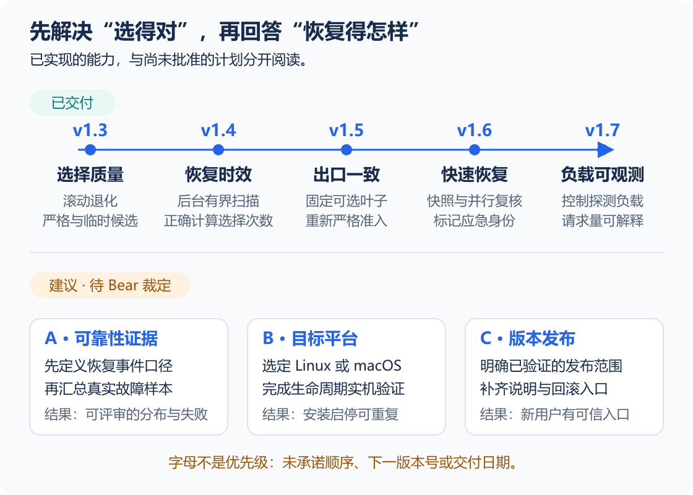

# 迭代计划与遗留问题

> [!NOTE]
> **已交付、待办、迭代建议分开看。** 历史来自Git与验证记录；Backlog是任务状态来源；未来建议仍待Bear裁定。

## 01 演进履历

**读图：** 上半部分为已有交付，下半部分为尚未批准的建议。A / B / C不是优先级，不承诺顺序、版本号或交付日期。

**已完成的开发阶段**

| 阶段 / 版本 | 当时要解决什么 | 交付变化 | 证据与限制 |
|---|---|---|---|
| 可用基线与守卫，2026-10-23 | 人工换节点、错误回滚、可见后台窗口和配置旁路 | 零依赖CLI、分级探测、隐藏计划任务、模式/DNS/客户端守卫 | 初始提交 `f284922`；后续守卫提交 `4c932ed`、`b3739eb`。Windows有实机记录，跨平台仍缺证据 |
| 选择质量，v1.3阶段 | 健康但偏慢、间歇退化和候选被过早淘汰 | 滚动退化、周期择优、严格/临时候选与安全恢复 | `d668c41`；策略演进不代表全网络条件最优 |
| 恢复时效，v1.4阶段 | 全候选扫描曾耗时约123–160秒；切前拒绝占用切换名额 | 后台3秒有界扫描、正确统计实际选择、及时清除扫描运行态 | `fb071ec`、`9394779`、`61cbe8e`；扫描时限与总恢复时限必须分开 |
| 出口一致，v1.5 | 嵌套自动组在验证期间继续换叶子 | 可直接选择时固定当前叶子并重新严格准入 | `73f5d04`；不对无法安全改写的合法拓扑强行扁平化 |
| 快速恢复，v1.6 | 故障后才扫描与串行复核增加等待 | 候选快照、并行有界复核、应急相对可用接管 | `9858738`；一秒目标仅适用于限定恢复窗口 |
| 负载可观测，v1.7 | 健康期全组探测频繁，状态无法解释隐含负载 | 降低快照刷新频率、受控逐节点并发、取消超时请求及负载统计 | `541eea8`；2026-10-25记录157项测试通过，真实Dry Run 2536ms且正式状态未改变 |
| 紧急恢复修复，v1.7.1 | 约750ms窗口拒绝较慢但可响应节点；局部成功又可能过早消耗预算 | 快速一轮无结果或不完整时追加最多3秒的一轮实时复核；保留相对改善、预算和待严格准入身份 | 2026-10-26共172项测试通过；真实扩展恢复在4.2秒内从日本05切到香港04，当次候选100%成功；后续节点仍抖动，不代表长期稳定 |

旧版评审中的30秒快照与60秒有效期属于旧方案。当前默认值由[工作原理](design.md)发布时自动读取；历史段落保留当时上下文，不充当当前配置手册。

2026-10-26实机收尾：自动恢复已触发，但多节点继续出现TLS超时并耗尽原有切换预算。六个跨地区候选两轮复核后，执行一次有日志的维护恢复至台湾02；其后三轮网络探测及三次412145字节文档下载均成功，后续延迟仍超过严格准入线。此次修复证明恢复控制流程可工作，不证明节点池或长期连接已经稳定。

## 02 当前遗留

**遗留问题：已确认待办与验证缺口**

下面是发布时从飞书Backlog读取的本项目记录，只在Backlog修改状态。飞书正文中的表格是有时间标记的阅读快照，不能当作实时任务系统。

<!-- sentinel:backlog -->

还需明确以下事实边界：

| 编号 | 类型 | 影响 | 目前如何处理 | 关闭条件 |
|---|---|---|---|---|
| GAP-01 | 验证缺口 | 缺少长期真实故障恢复分布，不能证明一秒SLO在日常环境的达标率 | 已有单次历史证据与耗时日志，尚未形成持续统计报告 | 按探测确认、快照命中、复核、选择分段采样，给出样本量、失败与超时分布；门槛由Bear批准 |
| GAP-02 | 交付缺口 | GitHub有源码但尚无Release；新用户难以识别哪一版经过什么验证 | 明确使用源码版本，不宣称存在正式发布包 | 在选定平台提供版本标签、变更说明、兼容范围、验证证据和可回滚入口 |
| LIMIT-01 | 设计限制 | 上游故障判断是启发式，可能受共享网络因素干扰 | 多目标与对照辅助判断，避免无依据反复切换 | 持续评估误判并记录证据；不承诺消除所有不确定性 |
| LIMIT-02 | 配置体验 | 新用户需要手工填写真实Selector和候选组 | 占位值未替换时给出明确错误；完整字段说明在README | 是否增加交互式向导待需求裁定，当前不是已批准开发项 |

GAP-01与GAP-02是本次盘点提出的候选工作，尚未自动写入已承诺的Backlog或设定优先级；LIMIT项用于说明能力边界，不能一概当作已复现缺陷。

## 03 下一轮建议

> [!WARNING]
> **尚未承诺。** 以下是按产品结果提出的迭代建议，不会自动创建正式任务、设定优先级或标记进行中。

**下一轮迭代建议：按结果验收**

| 建议迭代 | 要得到的产品结果 | 开发/验证阶段 | 完成条件 | 当前状态 |
|---|---|---|---|---|
| A 日常可靠性证据闭环 | 能回答“真实故障如何恢复、恢复有多快、有没有误切换” | 定义事件口径 → 利用现有日志采样 → 汇总分段耗时与失败 → 评审证据 | 报告有固定版本、环境、样本、故障类型、超时与不可恢复情况；验收目标先获批准 | 建议，待Bear裁定 |
| B 目标平台交付 | 某个Linux或macOS用户能可重复安装、启停、升级与卸载 | 选定平台 → 权限/凭据验证 → 生命周期与异常恢复 → 留存证据 | 对应平台Backlog验收标准关闭；不能用Windows静态检查代替 | 已有候选任务，顺序未定 |
| C 可复用版本发布 | 新用户能找到已验证版本与完整使用文档 | 选定发布范围 → 版本/文档检查 → 制品和回滚验证 → Release | 发布范围、来源Hash、变更说明、验证结果和回滚路径齐备 | 建议，待Bear裁定 |

上表是阶段结果规划；每个可执行任务仍需关联对应Backlog记录。不会因为写了路线图就将任务标为进行中，也不预设“下一个版本一定是v1.8”。

## 04 文档维护闭环

**文档与迭代如何保持一致**

### 唯一编辑处与责任

| 内容 | 唯一正文来源 / 状态来源 | 谁在什么事件更新 |
|---|---|---|
| 背景、范围、产品结论 | `PRODUCT.md` | 本次需求/产品负责人，在定位、范围或可用性变化时更新 |
| 操作与配置 | `README.md` | 本次实现者，在用户可见操作和配置变化的同一变更中更新 |
| 流程与设计取舍 | `docs/design.md` | 本次实现者，在控制流程或关键决策变化时说明原因和代价 |
| 迭代目标、阶段结果与已确认缺口 | `docs/iterations.md` | 本次需求/产品负责人，在迭代开始或验收结束时更新 |
| 执行任务状态 | 飞书Backlog | 执行者在开始、阻断、完成时更新；本页只读取快照 |

Bear只需要确认需求取舍、顺序和验收目标，不承担把聊天总结再抄进飞书的工作。以后接手本项目的开发Agent应将文档更新作为同一次交付的一部分。

### 每轮收尾只做这些事

1. 检查本次行为是否改变了背景/边界、用户操作、策略流程或阶段结论；只修改对应源页。没有影响也应能说明原因。
2. 执行 `npm run docs:check`，检查四页的必要内容、相对链接、标记与CLI帮助；原有测试继续检查README是否覆盖配置字段。
3. 执行 `npm run docs:publish` 预览：读取本项目Backlog，生成四篇飞书稿，比较源Hash和上次发布回执。默认不改飞书。
4. 执行 `npm run docs:publish -- --apply` 发布变化页：更新正文、核验读回，记录源Hash、线上revision和结果；远端有人手改或源内容在预览后变化时停止，不静默覆盖。
5. 检查本项目台账的文档同步日期；任何页面失败都报告为未全部发布，不宣称同步成功。没有飞书登录时保留源稿与预览结果，授权恢复后重试即可，无须重新整理内容。

发布工具不会重启Sentinel、探测代理、修改节点、提交Git或推送仓库。它仅处理固定四个飞书文档与本项目的文档同步日期。生成稿、回执和上一版正文保存在已忽略的 `var/docs-publish/`，凭据继续由lark-cli管理。

当前试行限制：发布环境需要Node.js、lark-cli与有效用户授权；更换工作目录或丢失本地回执时，必须先人工核对线上正文并恢复发布基线，工具会停止而不是强制覆盖。源文档仍需按正常Git流程提交，未提交的本地草稿不能冒充GitHub已发布版本。本轮未自动提交或推送。

机制是**事件触发、单向生成、按变化发布**：当前尚未配置定时任务或GitHub Actions，不能宣称无人值守自动同步。先验证本样例是否值得长期保留，再决定是否接入每次发布流程。

### 为什么本次不再增加一套大模板

公开实践提供的是取舍依据，不是证明本项目已经长期维护成功：

- [Diátaxis](https://diataxis.fr/application/)区分学习、操作、参考和解释。本项目采纳“按读者问题分工”，不照搬四套目录；小项目的操作与配置参考仍集中在一份README。
- [arc42架构决策](https://docs.arc42.org/section-9/)强调关键决策的背景、原因和后果，避免重复。本项目将已实现取舍放在设计说明，历史迭代只保留当时的问题、交付和证据，不再重复整篇设计。
- [GitLab文档工作流](https://docs.gitlab.com/development/documentation/workflow/)将用户可见变更的文档与代码交付关联。本项目试行由本次实现者同步更新，而不是要求Bear事后重新整理聊天记录。

约束是：只有出现实质内容和明确读者需求时才增加新文档；不预建空文件夹、不为每个小改动写独立报告、不在两处维护任务状态。发布脚本只能降低同步成本，不能替代事实审查和产品取舍。
